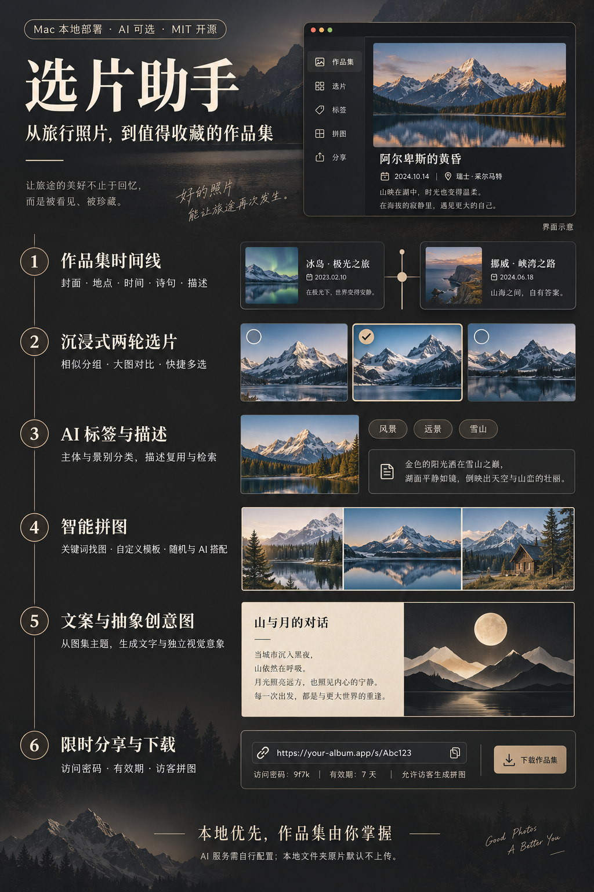

# 选片助手

> 独立手机版本正在开发：[iOS 使用、构建与 TestFlight 说明](docs/ios/README.md)。手机数据与网页版独立保存。


**把成百上千张旅行照片，整理成值得收藏和分享的作品集。**

一款以作品集为中心的照片管理工具：导入、相似分组、两轮选片，再用 AI 分类、找图、拼图和创作。首页是一条可编辑的作品集时间线，每个作品集有封面、地点、时间、一句诗和描述。

推荐在 **Mac 本地原生部署**，浏览器使用 **Chrome／Edge**。支持 Docker，采用 [MIT 许可证](LICENSE)。



*宣传图为 AI 生成的功能与界面示意，使用合成素材；实际界面以应用为准。*

## 能做什么

| 功能 | 使用方式 |
| --- | --- |
| 作品集时间线 | 每个作品集一张封面，按时间从早到晚排列；地点、日期、诗句和描述均可编辑，点击封面进入独立照片墙，每页 40 张渐进加载 |
| 两轮选片 | 相似照片分组、沉浸式大图对比、缩放与平移；初筛保留／待定／不要，精筛保留／不要；成功保存自动下一张，可撤销 |
| AI 标签与描述 | 初筛入选自动并发分类；标签库在设置中管理，按主体、景别、环境、风格检索，保存描述供创作复用 |
| 智能拼图 | 三拼、四拼、自定义主体与景别模板；按关键词和标签找图，随机组合或让多模态模型观察色彩、构图和人物朝向后推荐 |
| 文案与抽象创意图 | 遍历作品集描述提炼主题，生成可编辑文案或独立视觉意象；创意图使用文字提示词，不重新发送参考照片 |
| 分享与下载 | 指定作品集生成带密码和有效期的链接；可设置下载权限，允许访客拼图并保存到作品集 |

拼图支持逐格裁剪、缩放、换图、锁定、相框和水印。照片、拼图、AI 图片、文案分别保存；再次生成保留旧版本。无需配置 AI，也能完成选片、作品集管理和手工拼图。

## Mac 一键部署 · 推荐

### 准备

- macOS 14 或更新版本。
- [Node.js 24+](https://nodejs.org/)，包含 npm。已有 Homebrew 可运行 `brew install node@24`，脚本能识别其安装位置。
- 可选：Swift 6 工具链，用于 Apple Vision 和钥匙串。运行 `xcode-select --install` 安装 Command Line Tools；版本过旧时通过系统软件更新升级。

脚本不会静默安装 Homebrew。缺少 Swift 或构建不可用时，仍可使用传统 CV；未启用钥匙串时密钥保存在本地加密凭据中。

```sh
git clone https://github.com/WuJean/photo-selector.git
cd photo-selector
./deploy.sh
```

脚本安装依赖、构建网页和可用的 VisionWorker，然后在后台启动**生产服务**。终端会显示本机地址、局域网地址和分享地址。

打开 [http://localhost:4173](http://localhost:4173)，首次密码为 **`passwd`**。首次登录必须设置至少 12 位的新密码。**默认监听 `0.0.0.0`，请先在本机完成改密，再把访问地址发给别人。** 更新不会重置已有密码。

已有其他程序占用端口时，脚本会退出，不会停止那个程序。可指定其他端口：

```sh
PHOTO_SELECTOR_PORT=4181 ./deploy.sh
```

### 日常使用

```sh
./deploy.sh status       # 查看运行状态
./deploy.sh stop         # 停止，保留全部数据
./deploy.sh start        # 启动已构建版本
./deploy.sh restart      # 重启已构建版本
./deploy.sh logs         # 查看日志，Ctrl-C 退出日志查看

# 更新：先备份，再拉取并重新部署
git pull --ff-only
./deploy.sh
```

默认数据位于项目 `.local/`，运行记录和日志位于 `.local/run/`。后台运行不等于开机启动，本版不会自动添加登录项。Mac 休眠、关机或服务停止期间，分享页面不可访问。

## 第一次整理照片

1. 进入「导入与筛选」，连接电脑文件夹、普通上传或粘贴公开图片直链。已选好的照片可直接入库。
2. 初筛标为“不要”的照片从决定成功起保留三小时，然后自动清理服务器副本；到期前可以恢复。未处理、保留、待定及仍有作品集／分享引用的照片不按此规则删除，电脑源文件不删除。
3. 入选照片进入精筛，同时自动排队 AI 分类；无需等待标签即可继续筛选。
4. 将精筛保留的照片归入作品集，同一照片可复用到多个作品集。
5. 在「编辑作品集」弹窗中填写地点、日期、诗句和描述。日期留空时取最早拍摄时间，缺失时取导入时间。
6. 从作品集打开拼图与创作，或创建分享链接。

| 操作 | 快捷键 |
| --- | --- |
| 初筛待定／保留／不要 | Z／X／C |
| 精筛保留／不要 | X／C |
| 进入／退出沉浸 | 空格；Esc 退出 |
| 切换照片 | ←／→ |
| 撤销 | Command-Z／Ctrl-Z |
| 多选／连续选择／追加范围 | Command 或 Ctrl 点击／Shift 点击／组合使用 |

列表批量决定作用于已选照片；卡片按钮只处理单张。筛选、范围或排序改变时清空选择，失败保留位置，撤销恢复整批决定。

## AI 配置与数据去向

在管理页面打开「设置」，填写图片理解服务的 **API Base URL、模型名称、API Key**。使用支持图片输入的 Chat Completions 兼容服务，也可以接入符合协议的本地模型。

本地 Qwen 网关请选择「本地 Qwen 网关」服务类型，地址例如 `http://127.0.0.1:8765/v1`。支持本机图片分类、描述、视觉搭配和文案生成，默认并发 1，故障不会回退到云端；已有分析直接复用。公网 HTTPS 访问也由服务所在电脑完成推理。配置及隧道发布方法见 [部署说明](docs/DEPLOYMENT.md#本地-qwen-与公网-https)。

- 初筛保留／待定后即自动分类，已有入选照片补齐缺失标签和描述；没有服务配置时等待，不阻碍选片。分类默认并发 8、服务共享上限 8，可调节。标签库仅在设置中修改，修改不自动重跑旧照片；重新分类需明确点击确认，可能产生费用。
- 标签包含主体、景别及最多五个附加标签；同时保存客观描述。已有描述供检索、文案和创意图复用，只补充缺失项。
- AI 视觉搭配需要实际查看候选预览；拼图筛选范围、锁定条件和模板要求都会被校验。
- 生图配置独立，默认 `wan2.7-image`，使用原生生图接口而非 Chat Completions。实际服务与套餐需支持对应模型。
- **AI 服务由你配置，可能收费**；随机拼图和访客拼图不会新增模型调用。

**本地文件夹原片默认不上传。** 浏览器保存目录授权并读取照片，服务器保存元数据、标签和作品集关系。AI 按需接收去除 EXIF 的压缩预览；分享时上传必要的展示副本，开放原片下载才上传原片副本。普通上传模式则把照片保存在服务器。

本地文件夹访问需要 **localhost 或 HTTPS**。局域网普通 HTTP 下不能使用目录授权，可使用普通上传。浏览器之间、localhost 与局域网地址之间不共享目录授权；离线照片在作品集中重新连接文件夹。浏览器文件夹分析使用浏览器 CV；Apple Vision 用于 Mac 服务端上传照片的分析。

## Docker 部署

适合已有 Docker 的 Mac／Windows／Linux 用户；不使用 Apple Vision 和 macOS 钥匙串，使用传统 CV 与本地加密凭据。

```sh
./deploy.sh --docker
./deploy.sh --docker status
./deploy.sh --docker logs
./deploy.sh --docker stop
```

Windows 在 WSL 中运行。Mac 上 `./deploy.sh` 默认原生运行，Docker 必须显式加 `--docker`；非 Mac 默认 Docker。两种方式使用各自的数据目录／卷，不会自动迁移数据。

## 局域网与公网访问

默认端口 `4173`，监听 `0.0.0.0`。复制 `.env.example` 为 `.env` 后可配置：

```dotenv
PHOTO_SELECTOR_PORT=4173
PHOTO_SELECTOR_BIND=0.0.0.0
# 需要公网分享时，填写已配置 HTTPS 反向代理的地址
# PHOTO_SELECTOR_PUBLIC_URL=https://photos.example.com
# 可额外指定其他准确访问地址，逗号分隔
# PHOTO_SELECTOR_ALLOWED_ORIGINS=http://192.168.1.20:4173
```

命令环境变量优先于 `.env`，已有显式配置不会被覆盖。只供本机使用可设置 `PHOTO_SELECTOR_BIND=127.0.0.1`。没有指定公开地址时，部署脚本优先选取局域网地址，分享链接使用该地址；网络地址变化后重新部署。

`0.0.0.0` 只是监听设置，不是访问网址，也不会自动穿透路由器。公网服务需要可达的服务器或网络转发、域名和 HTTPS 反向代理；本项目不自动配置路由器或隧道。地址校验与管理员登录继续生效，作品集不会因为源码公开或监听全部网卡而变成公开相册。

详细配置、代理、备份恢复及故障处理见 [部署说明](docs/DEPLOYMENT.md)。

## 备份与限制

更新不会清库。原生备份请先 `./deploy.sh stop`，复制完整数据目录，再 `./deploy.sh start`；使用钥匙串的密钥还需保留系统钥匙串或自行安全保存。Docker 备份整个数据卷，操作见部署说明。

服务器备份不包含电脑文件夹原片和浏览器目录授权，电脑照片请另外备份。网络导入照片写入电脑并核对摘要后才清理服务器中转；初筛淘汰副本完成清理后无法撤销。

适用于单管理员、单服务实例。首版主要处理 JPEG，不包含 RAW 显影、图床接入、云同步、专业修图评级同步或自动发布朋友圈。微信小程序是独立实现，见 [小程序说明](wechat/README.md)，不与网页版自动同步。

## 开发与测试

```sh
npm ci
npm run dev             # 开发模式，请勿用作对外生产服务
npm run check           # 服务与算法测试、生产构建
npm run test:browser     # 浏览器交互
npm run test:native      # Mac 原生生产部署、更新与恢复（隔离测试库）
npm run test:docker      # Docker 构建、重建与备份恢复
```

React／Express／SQLite；共享排版规则、浏览器 Worker、本地文件访问和可配置 AI 适配器。[测试记录](docs/TESTING.md) 区分模拟验证、真实服务验证和未实测范围。

代码、文档及宣传图按 [MIT](LICENSE) 提供。照片、数据库、配置、缓存、密钥和导出文件不提交到仓库。

## 手机和平板

手机与 Mac 连接同一局域网，使用启动时显示的局域网地址打开网页并登录。

- 从相册多选 JPEG、PNG、HEIC／HEIF 静态照片，默认两张并行上传。原文件保留，兼容预览另存；失败可单独重试，同一次上传重试不重复入库。Live Photo 的视频不在支持范围。
- 单击照片进入沉浸选片，左右滑动切换照片，双指缩放、放大后单指移动。底部大按钮作出决定后自动下一张；滑动本身不会保留或淘汰。
- 点击“选择”进入多选。作品集编辑、拼图、生成创意图分别打开独立弹窗；手机拼图通过“画布／选照片／样式”切换面板。
- 时间线打开的是当前作品集的独立照片墙，返回保留位置。作品集管理仍在“作品集”入口。
- 普通上传把文件存到服务器；电脑目录授权不能转移到手机。手机看不到仅保存在另一台电脑文件夹的原片；已发布分享的在线副本不受此限制。
- 三小时清理由服务器执行。服务休眠或关闭时顺延到下次启动；引用中的照片受到保护，删除失败会重试。已清理的服务器副本不能通过撤销恢复。

手机切到后台时浏览器可能中断未完成上传；返回页面可重试。刷新或关闭页面后需要重新选择尚未上传的文件，已成功上传的照片保留。真实设备体验以设备浏览器为准，自动化覆盖范围见 [测试记录](docs/TESTING.md)。

## 手机远程选片与 R2

手机初筛、精筛和沉浸浏览默认使用压缩 WebP 展示图：列表 480 像素，手机／平板大图 1080 像素，桌面大图 1600 像素。原片不压缩覆盖，主动查看原尺寸或下载时才传原图。

可接入私有 Cloudflare R2，使展示图直接从云端返回，减少本机上传带宽。电脑文件夹只同步压缩展示图；旧照片在原电脑重新连接文件夹后补同步。作品集、分享密码、有效期和撤销权限继续生效。部署步骤、计费边界与故障回退见 [R2 接入说明](docs/R2.md)。
